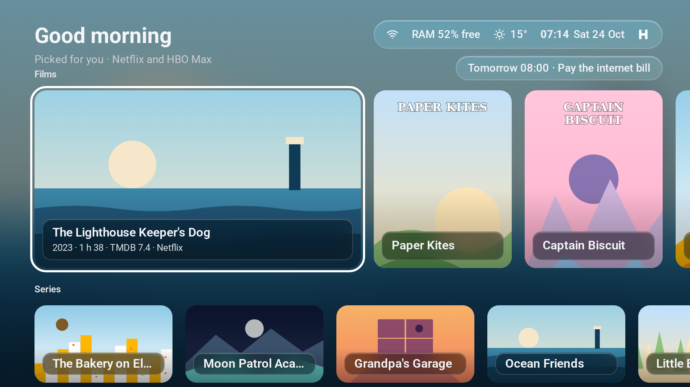
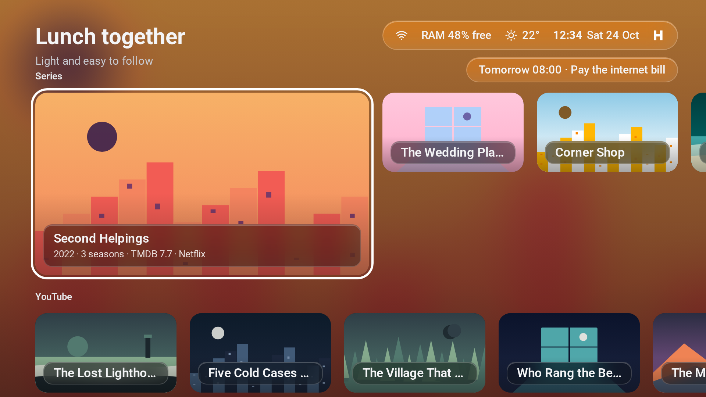
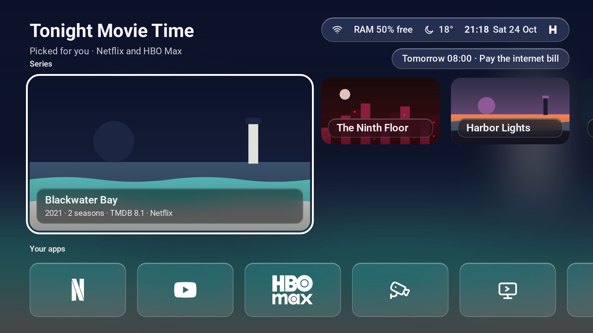
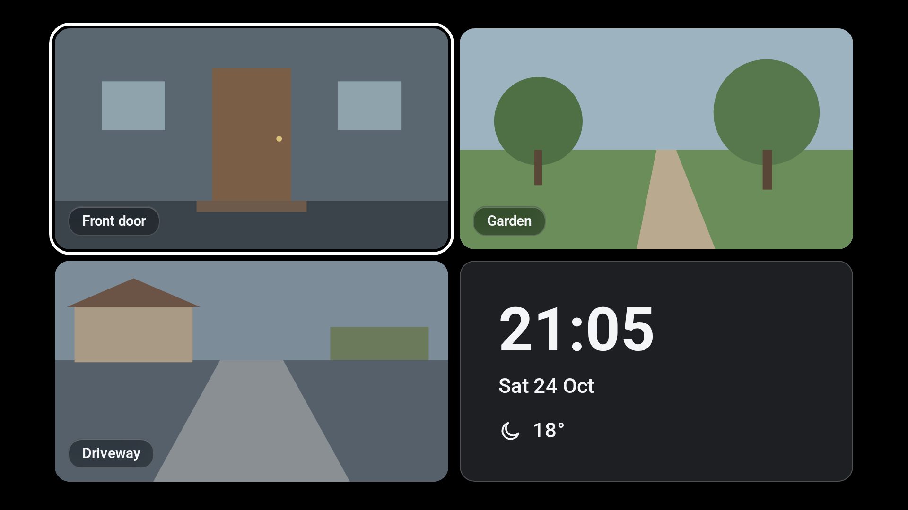
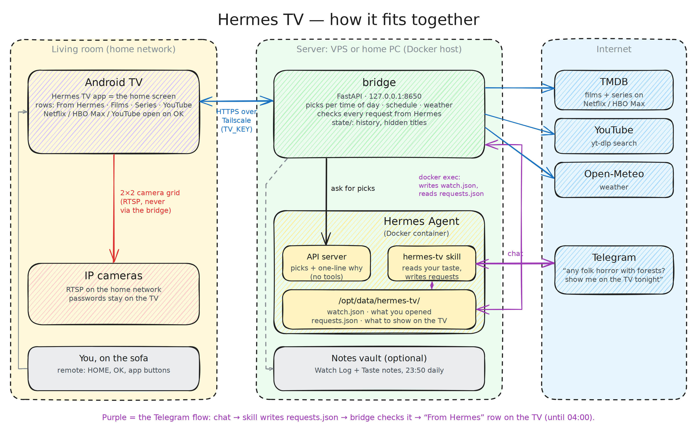
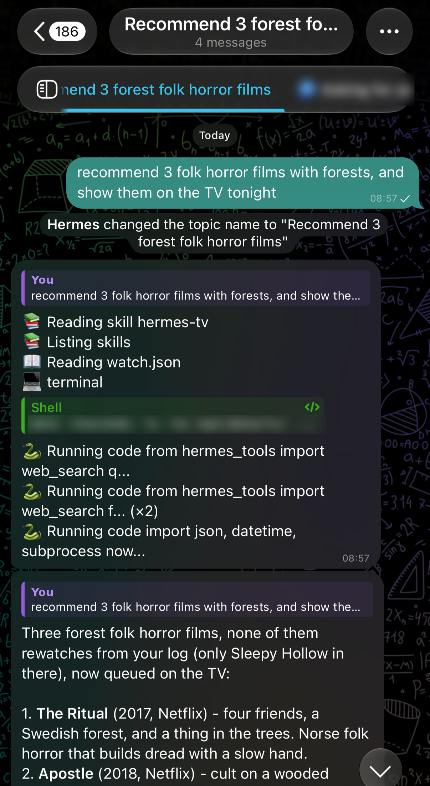
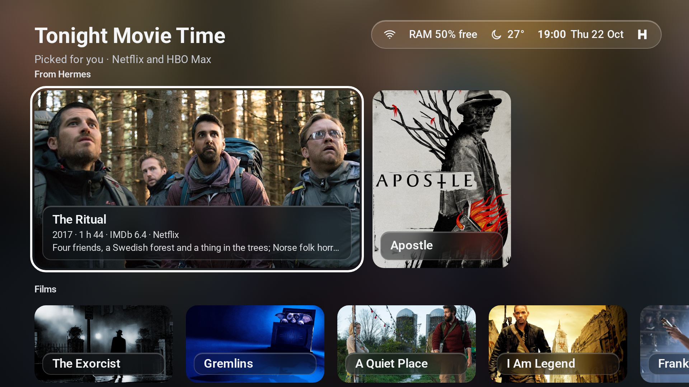

<p align="center">
  
</p>

<h1 align="center">Hermes TV</h1>

<p align="center"><b>Turn your Android TV into a really smart TV.</b><br>
No ads. The right picks for the time of day. Your own AI agent. Your cameras on the big screen.</p>

<p align="center">
  
  
  
  
  
  
  
</p>


## Why this exists

Our "smart" TV was not smart. The stock Google TV home was full of ads and rows that we never asked for.
We wanted a TV that knows us:

- **It knows the time of day.** Light comedies at lunch, a good horror or sci-fi film at night.
- **It knows your taste.** Your own AI agent picks from what streams tonight and says why.
- **It knows your house.** The cameras show on the TV in one press, with no cloud app.

Hermes TV makes that real. It replaces the TV's home screen. A small service on a home server (the "bridge") finds the picks.
A [Hermes Agent](https://github.com/NousResearch/hermes-agent) on your own machine can choose from them and say why. Hermes is optional.

This README also lists every problem we hit on a TCL Smart TV Pro G09, with the fix.

## What it does

| Time (bridge `TIME_ZONE`) | Label | Films and series | Rows |
|---|---|---|---|
| 06:00–10:59 | Good morning | comedy, family or animation, no horror, TMDB 7.0+ | Films, Series |
| 11:00–13:59 | Lunch together | comedy, family or romance in `LOCAL_LANGUAGE`, no horror, TMDB 6.5+ | Films, Series, YouTube |
| 14:00–16:59 Mon–Fri | Top rated for you | any genre, TMDB 7.5+ | Films, Series |
| 14:00–16:59 Sat–Sun | Weekend family films | family, animation or comedy, no horror, TMDB 7.0+ | Films, Series |
| 17:00–18:59 | Dinner together | as at lunch | Films, Series, YouTube |
| 19:00–03:59 | Tonight Movie Time | horror or sci-fi; films TMDB 7.0+, series TMDB 7.5+ | Films, Series |
| 04:00–05:59 | Top rated for you | any genre, TMDB 7.5+ | Films, Series |

Documentaries never show in the Films and Series rows. The slots and the taste are plain code in `bridge/hermestv/slots.py`: edit them to change the rules.

- **Rows.** Films and series come from [TMDB](https://www.themoviedb.org/) and are on Netflix or HBO Max in your `REGION` now. Each card shows `year · length · TMDB 7.4 · service`. OK on a card opens the service app on its home page (TMDB has no link to a title). The last film card, "All films ›", opens a full-screen picker that also shows Hermes's one-line reason for each pick.
- **YouTube row** (lunch and dinner): videos of 5 to 60 minutes from your `YOUTUBE_QUERIES` searches, found with [yt-dlp](https://github.com/yt-dlp/yt-dlp). OK opens the video in the YouTube app.
- **Learning.** The bridge remembers what you open and gives Hermes the titles as taste hints. Hold OK for 0.6 s on a card for "Not for us" or "Hide this channel".
- **From Hermes row** (optional): ask Hermes for films in a chat app, and its picks show at the top of Home. See [Ask Hermes in chat](#ask-hermes-in-chat-optional).
- **Dock** ("Your apps"): your TV apps as large tiles, Netflix, YouTube and HBO Max first, then by use, then Inputs and Settings. Hold OK on a tile to hide it.
- **Status pill:** network, free RAM, weather, time, date and the Hermes mark (a dimmed mark with × means Hermes does not answer).
- **Schedule line:** the next item of your Hermes schedule under the pill, for example `Tomorrow 08:00 · Pay the internet bill`.
- **Cameras:** a Cameras tile opens a 2×2 grid of up to 4 RTSP cameras. OK opens one camera full screen. A stream that stops starts again after 10 s. With fewer than 4 cameras, the last cell shows the clock, the date and the weather.
- **Idle screen:** a screensaver with Japanese scenery photos from Wikimedia Commons that change with the time of day, a slow pan, the clock, the weather and the schedule.
- **Remote buttons:** the Netflix, YouTube and other app buttons work again (see [Remote buttons](#remote-buttons)).

| Good morning | Lunch together |
|---|---|
|  |  |
| **Tonight Movie Time** | **Cameras** |
|  |  |

<sub>Drawn stand-ins: the real app shows TMDB posters and live camera video.</sub>

## How it fits together

<p align="center">
  
  <br>
  <sub>Edit the diagram: open <code>docs/architecture.excalidraw</code> at <a href="https://excalidraw.com">excalidraw.com</a>.</sub>
</p>

```text
 Android TV (Hermes TV app)
   |                      \
   | HTTPS over Tailscale   \ RTSP on your home network (camera passwords stay on the TV)
   v                         v
 bridge (FastAPI, 127.0.0.1:8650,          IP cameras
         published with `tailscale serve`)
   |-- Hermes Agent API server (optional) : chooses picks, gives the "why"
   |-- Hermes container, `docker exec`     : reads the schedule; writes watch.json, reads requests.json
   |-- TMDB API                            : films and series on Netflix and HBO Max
   |-- yt-dlp                              : YouTube searches
   |-- Open-Meteo                          : weather
   '-- bridge/state/                       : history, hidden items, scenery photos

 You, in a chat app (for example Telegram)
   |
   v
 Hermes Agent with the hermes-tv skill (optional)
   '-- /opt/data/hermes-tv/ in its container : reads watch.json, writes requests.json
                                               -> the "From Hermes" row on the TV
```

- The TV talks only to the bridge, and only over your tailnet (a private Tailscale network). The app refuses a bridge address that is not a tailnet address.
- Every `/v1` call needs the `TV_KEY` bearer token. Only `/health` is open.
- Hermes runs with no tools for the bridge. The `hermes-tv-gate` plugin blocks every tool on API-server runs, because YouTube titles from strangers go into the prompts.
- Hermes has no bridge key and no network path to the bridge. The chat path is two files in one folder, and only the bridge moves them, with `docker exec`.

## What you need

- An Android TV or Google TV with **Android 12 or newer**. The remote-button codes in this repo are for TCL.
- A computer with `adb` ([Android platform-tools](https://developer.android.com/tools/releases/platform-tools)), JDK 17 and the Android SDK (platform 34, build-tools 34.0.0) for the build. [Android Studio](https://developer.android.com/studio) installs the SDK and a JDK. You need the computer once, and again for each update.
- An always-on Linux machine for the bridge with **Python 3.12 or newer**: a Raspberry Pi, a NAS, an old laptop or a home server.
- A free [Tailscale](https://tailscale.com/) account, with MagicDNS and HTTPS certificates turned on for your tailnet.
- A free [TMDB API key](https://www.themoviedb.org/settings/api).
- Optional: a [Hermes Agent](https://github.com/NousResearch/hermes-agent) in Docker. Tested with `nousresearch/hermes-agent:v2026.9.21`.
- Optional: 1 to 4 IP cameras with RTSP, and [FFmpeg](https://ffmpeg.org/) (`ffprobe`) or [VLC](https://www.videolan.org/vlc/) on the computer to test the camera URLs.

## Set it up with an AI agent

The repo has an [AGENTS.md](AGENTS.md) with the full setup flow and the rules for an agent.

- **Coding agent (Claude Code, Codex, Cursor and others):** open it in a clone of this repo on the computer that will build the app, and say "Set up Hermes TV on my TV." The agent reads `AGENTS.md` by itself (Claude Code through `CLAUDE.md`).
- **Chat-only agent:** paste this prompt:

  ```text
  Read https://github.com/aryswisnu/hermes-tv/blob/main/AGENTS.md and follow its Setup section with me, step by step.
  ```

The agent first asks you for the TV address, the bridge machine, Hermes, the TMDB key, your location and region, and your cameras.
It asks before it disables a package that is not in the example list. It writes `restore-my-tv.sh`, which undoes its changes.

## Without Hermes

Leave `HERMES_URL` empty in `bridge.env`. The bridge then never calls Hermes.

What still works:

- The Films and Series rows, ranked by TMDB rating, and the YouTube row, ranked by views.
- The cameras, the weather, the idle screen, the dock and the remote buttons.

What is off:

- The one-line "why" for each pick.
- The schedule line and the idle-screen schedule (they read Hermes jobs).
- The Hermes mark in the status pill.
- The "From Hermes" row. Nothing writes `requests.json`, so the row never shows.

To turn Hermes on later, set `HERMES_URL` and `HERMES_KEY` in `~/.config/hermes-tv/bridge.env`, then run `systemctl --user restart hermes-tv-bridge`. You do not need to rebuild the TV app.

## Set it up by hand

### 1. The bridge

On the always-on Linux machine. The systemd unit expects the clone at `~/hermes-tv`.

```sh
git clone https://github.com/aryswisnu/hermes-tv ~/hermes-tv
cd ~/hermes-tv/bridge
python3.12 -m venv .venv
.venv/bin/pip install -e .
mkdir -p ~/.config/hermes-tv
cp bridge.env.example ~/.config/hermes-tv/bridge.env
chmod 600 ~/.config/hermes-tv/bridge.env
openssl rand -hex 32        # paste the output as TV_KEY in bridge.env
~/hermes-tv/tools/fetch-scenery.sh
```

Edit `~/.config/hermes-tv/bridge.env`:

| Setting | What it does |
|---|---|
| `TV_KEY` | The token the TV sends. **Empty means the bridge starts, but answers 401 to every `/v1` request.** Make one with `openssl rand -hex 32`. Put the same value in `tv/bridge.properties`. |
| `HERMES_URL`, `HERMES_KEY` | The Hermes API server, for example `http://127.0.0.1:8642`, and its key. An empty `HERMES_URL` is [Without Hermes](#without-hermes) mode. |
| `HERMES_CONTAINER` | The Docker container of Hermes (default `hermes`). The bridge reads the schedule with `docker exec`, so the bridge user must be allowed to run `docker`. **Docker access gives the bridge user root-level access to the host.** If that is not acceptable, leave `SCHEDULE_JOBS`, `HERMES_TV_DIR` and `HERMES_VAULT_TV_DIR` empty: the bridge then never runs `docker`. |
| `SCHEDULE_JOBS` | A comma list of the **exact** names of the Hermes jobs that the TV may show. Empty shows no schedule. |
| `HERMES_TV_DIR` | The folder in the Hermes container that the bridge shares with the `hermes-tv` skill, `/opt/data/hermes-tv`. Empty turns [Ask Hermes in chat](#ask-hermes-in-chat-optional) off (the default). |
| `HERMES_VAULT_TV_DIR` | Optional: a folder under `/opt/data/` in the Hermes container for two daily notes, `Watch Log.md` and `Taste.md`. Empty turns them off (the default). |
| `TIME_ZONE` | An IANA name such as `America/New_York` (default `UTC`). It sets the slots, the schedule day and the scenery. Use the TV's time zone. |
| `LATITUDE`, `LONGITUDE` | Your location for [Open-Meteo](https://open-meteo.com/). Set both, or there is no weather. |
| `TMDB_API_KEY` | A TMDB API key or read access token. Empty gives empty Films and Series rows. |
| `REGION` | The country for streaming availability, ISO 3166-1 (default `US`). |
| `LOCAL_LANGUAGE` | The original language of the lunch and dinner titles, ISO 639-1 (default `en`). |
| `YOUTUBE_QUERIES` | A comma list of YouTube searches. An empty value turns the YouTube row off. No line at all uses the English defaults. |
| `YOUTUBE_EXCLUDE` | A comma list of words or phrases. A video whose title or channel holds one as a whole word is skipped, for example `cooking,recipe`. |

Netflix and HBO Max are TMDB watch providers `8` and `1899` (`PROVIDERS` in `bridge/hermestv/catalog.py`). Check the ids for your region with your key:

```sh
# with an API key
curl -s "https://api.themoviedb.org/3/watch/providers/movie?watch_region=US&api_key=<your key>" | python3 -m json.tool | grep -B1 -A3 -E '"provider_name": "(Netflix|HBO Max|Max)"'
# with a read access token
curl -s -H "Authorization: Bearer <read access token>" "https://api.themoviedb.org/3/watch/providers/movie?watch_region=US" | python3 -m json.tool | grep -B1 -A3 -E '"provider_name": "(Netflix|HBO Max|Max)"'
```

A card opens the service app on its home page. The HBO Max address can be `max.com` or `hbomax.com`, which differs by region. The app accepts both.

Start the bridge as a systemd user service:

```sh
mkdir -p ~/.config/systemd/user
cp ~/hermes-tv/bridge/hermes-tv-bridge.service ~/hermes-tv/bridge/hermes-tv-ytdlp-update.service ~/hermes-tv/bridge/hermes-tv-ytdlp-update.timer ~/.config/systemd/user/
systemctl --user daemon-reload
systemctl --user enable --now hermes-tv-bridge.service hermes-tv-ytdlp-update.timer
loginctl enable-linger "$USER"     # keeps the bridge running when you log out
curl -s http://127.0.0.1:8650/health
```

The bridge listens on `127.0.0.1:8650` only. Publish it on your tailnet, never on the internet:

```sh
sudo tailscale serve --bg --https=8444 http://127.0.0.1:8650
tailscale serve status        # shows https://<host>.<tailnet>.ts.net:8444
```

> [!WARNING]
> Use `tailscale serve`, never `tailscale funnel`. Funnel puts the bridge on the public internet.

Check the bridge with your key. The first call can return an empty list while the bridge fills its cache: call it again after 1 minute.

```sh
curl -s -H "Authorization: Bearer $(sed -n 's/^TV_KEY=//p' ~/.config/hermes-tv/bridge.env)" "http://127.0.0.1:8650/v1/picks?row=films"
```

### 2. Hermes (optional)

Skip this part for [Without Hermes](#without-hermes) mode. These steps match `nousresearch/hermes-agent:v2026.9.21`. Check the Hermes documentation for your version.

1. Turn on the Hermes API server. Set `API_SERVER_KEY` in the Hermes data `.env`, and `API_SERVER_HOST=0.0.0.0` (this is inside the container). Publish port 8642 on the host loopback only: `-p 127.0.0.1:8642:8642`.
2. Install the gate plugin. Copy `hermes-plugin/hermes_tv_gate/__init__.py` and `plugin.yaml` to `<hermes data>/plugins/hermes-tv-gate/`. Add `- hermes-tv-gate` under `plugins:` → `enabled:` in `<hermes data>/config.yaml`.
3. Restart Hermes (`docker restart hermes`). Check: `curl -s http://127.0.0.1:8642/health`.
4. In `bridge.env`, set `HERMES_URL=http://127.0.0.1:8642` and `HERMES_KEY` to the `API_SERVER_KEY` value. Restart the bridge.

> [!CAUTION]
> The gate plugin blocks every tool on **every** API-server run, not only the bridge's runs. Do not install it if another program uses the same Hermes API server with tools.

**Schedule line.** The bridge reads `/opt/data/cron/jobs.json` in the Hermes container and shows only the enabled jobs named in `SCHEDULE_JOBS`. It shows one-time jobs, and agent cron jobs that run at one fixed time of day. It skips script jobs. The job name is the text on the TV, so name a job like `Pay the internet bill`.

Hermes runs cron jobs in its container's time zone. Give the container the same zone as `TIME_ZONE` (for example `TZ=America/New_York` in its environment), or the times on the TV are wrong.

### 3. Connect to the TV over adb

**Show Developer options:** Settings → System → About → move to "Android TV OS build" and press OK 7 times.

**Find the TV's IP address:** Settings → Network & Internet → select your Wi-Fi network.

Try the three ways in this order:

1. **USB debugging.** Settings → System → Developer options → turn on "USB debugging". On many Android TVs, TCL included, this also opens adb on the network. Run `adb connect <tv-ip>:5555`.
2. **Wireless debugging** (Android TV / Google TV 11 and newer). Developer options → "Wireless debugging" → "Pair device with pairing code". Run `adb pair <tv-ip>:<pairing-port>` and type the code. Then run `adb connect <tv-ip>:<port>`, with the port that the Wireless debugging screen shows (not 5555). The tools in this repo use port 5555, so move adb to it:

   ```sh
   adb -s <tv-ip>:<port> tcpip 5555
   adb connect <tv-ip>:5555
   ```

   Port 5555 stays open until the TV restarts. After a restart, do way 2 again.
3. **A USB cable, once.** If neither works over Wi-Fi, connect the computer to the TV with a USB cable. Not every TV accepts adb on its USB port: check the TV's manual. Run `adb tcpip 5555`. Unplug the cable and use way 1.

The TV shows "Allow USB debugging?" the first time. Select "Always allow from this computer" and OK. Check with `adb devices`: the TV must show as `device`, not `unauthorized`.

### 4. The TV app

1. Install Tailscale on the TV from the Play Store and sign in to the same tailnet as the bridge.
2. Write the two config files. Both are gitignored, so your keys and camera passwords never go into git.

   ```sh
   cd ~/hermes-tv/tv
   cp bridge.properties.example bridge.properties     # BRIDGE_URL=https://<host>.<tailnet>.ts.net:8444, TV_KEY=<same as bridge.env>
   cp camera.properties.example camera.properties     # optional: see Cameras
   ```

   `camera.properties` holds `CAMERA_n_URL`, `CAMERA_n_SUB_URL`, `CAMERA_n_NAME` and `CAMERA_n_FULL` for n = 1 to 4. Without a camera URL, the app has no Cameras tile.

3. Build. You need JDK 17 and the Android SDK. Set `ANDROID_HOME`, or write `sdk.dir=<sdk path>` in `tv/local.properties`.

   ```sh
   ./gradlew assembleRelease
   ```

   The build stops when `tv/bridge.properties` is missing. `./gradlew clean` also needs it. The APK is `tv/app/build/outputs/apk/release/app-release.apk`. The config is compiled into the APK, so there is no prebuilt release.

4. Install. The script also turns on the remote-button accessibility service.

   > [!NOTE]
   > `tools/tv-install.sh` replaces the whole list of enabled accessibility services. Another service, such as TalkBack, turns off. Read the list first with `adb shell settings get secure enabled_accessibility_services` and keep the value. To keep another service on, put both back, separated by `:`, for example `adb shell settings put secure enabled_accessibility_services <old value>:hermestv.launcher/.NetflixKeyService`.

   ```sh
   cd ~/hermes-tv
   TV_IP=<tv-ip> tools/tv-install.sh tv/app/build/outputs/apk/release/app-release.apk
   ```

5. Set Hermes TV as the home screen:

   ```sh
   adb shell cmd package set-home-activity --user 0 hermestv.launcher/.HomeActivity
   ```

   On Google TV this has no effect until the stock home is disabled (step 6).

6. Disable the stock home and the apps you do not use. `tools/debloat.sh` runs `pm disable-user` only, never `pm uninstall`, so `tools/restore.sh` can undo it. It refuses a set of core packages and every package in the never-disable list.

   > [!WARNING]
   > `examples/tcl-g09/disabled.txt` is for one TCL model. Check your own package list (`adb shell pm list packages`) and remove the lines you do not want. The list disables the stock launchers: install Hermes TV and set it as home **first** (steps 4 and 5).

   ```sh
   TV_IP=<tv-ip> tools/debloat.sh examples/tcl-g09/disabled.txt examples/tcl-g09/never-disable.txt
   adb shell cmd package set-home-activity --user 0 hermestv.launcher/.HomeActivity
   adb shell input keyevent KEYCODE_HOME
   ```

7. Turn on the idle screen:

   ```sh
   adb shell settings put secure screensaver_components hermestv.launcher/.IdleDream
   adb shell settings put secure screensaver_enabled 1
   adb shell service call dreams 1      # shows it now; press any button to leave
   ```

8. Run the [7-test check list](#7-test-check-list).

To update later: `git pull`, build again, run `tools/tv-install.sh` again, and run `systemctl --user restart hermes-tv-bridge`.

## Ask Hermes in chat (optional)

Ask your Hermes Agent for films in a chat app, for example Telegram: "Any folk-horror films set in a remote village? Show them on the TV tonight."
Hermes reads what the TV opened, skips what you watched lately, and recommends titles on Netflix or HBO Max (or on an [extra source](#extra-source-optional), if you set one).
When you ask, it puts its picks on the TV. A "From Hermes" row at the top of Home shows them until the next 04:00. The focused card shows Hermes's one-line reason under the meta line.

<table>
  <tr>
    <td width="32%"></td>
    <td width="68%"></td>
  </tr>
</table>

<sub>Left: a real chat, with the sender name and one command line blurred. Right: the home screen drawn from the app's layout with live bridge data. Film images © their owners.</sub>

The bridge and Hermes share one folder in the Hermes container, `/opt/data/hermes-tv/`:

| File | Written by | Read by | What it holds |
|---|---|---|---|
| `watch.json` | the bridge, 1 minute after you open or hide a title on the TV | Hermes | the last 500 titles that the TV opened, the hidden titles, and counts of genres, kinds, services and time of day |
| `requests.json` | Hermes, with the `hermes-tv` skill | the bridge, for `GET /v1/picks?row=hermes` | up to 10 titles, each with a one-line reason |

### Set it up

You need the bridge with a TMDB key, and Hermes in Docker on the same machine as the bridge (parts 1 and 2 of [Set it up by hand](#set-it-up-by-hand)). The bridge user must be allowed to run `docker`.

1. In `~/.config/hermes-tv/bridge.env`, set the shared folder:

   ```sh
   HERMES_TV_DIR=/opt/data/hermes-tv
   ```

   Optional: set `HERMES_VAULT_TV_DIR` to a folder under `/opt/data/`, for example in a notes vault that Hermes uses. Each day at 23:50 (`TIME_ZONE`), the bridge writes `Watch Log.md` (the last 100 opens) and `Taste.md` there.
2. Restart the bridge: `systemctl --user restart hermes-tv-bridge`.
3. Install the skill in the Hermes container, as the owner of `/opt/data` (Hermes runs as that user). Replace `hermes` with your `HERMES_CONTAINER`.

   ```sh
   cd ~/hermes-tv
   docker exec -i -u "$(docker exec hermes stat -c %u:%g /opt/data)" hermes sh -c 'mkdir -p /opt/data/skills/media/hermes-tv && cat > /opt/data/skills/media/hermes-tv/SKILL.md' < hermes-skill/hermes-tv/SKILL.md
   ```

   `nousresearch/hermes-agent:v2026.9.21` reads skills from `/opt/data/skills/`. Check the skills folder for your Hermes version. If Hermes does not use the skill, start a new conversation.

Check that it works:

1. Open a film on the TV. After 1 minute, `docker exec hermes cat /opt/data/hermes-tv/watch.json` shows the film.
2. Ask Hermes in chat: "Recommend 3 films for tonight and show them on the TV."
3. Ask the bridge for the row. It lists the titles that it found on Netflix or HBO Max:

   ```sh
   curl -s -H "Authorization: Bearer $(sed -n 's/^TV_KEY=//p' ~/.config/hermes-tv/bridge.env)" "http://127.0.0.1:8650/v1/picks?row=hermes"
   ```

4. Press HOME on the TV, a few seconds after Hermes writes the file. HOME fetches the row, and the "From Hermes" row is at the top.

The `hermes-tv-gate` plugin blocks tools only on API-server runs. Chat runs keep their file tools, and the skill needs them.

### Safety rules

- Hermes gets no bridge key and no network path to the bridge. It reads and writes files in one folder with its own file tools.
- The bridge reaches the folder only with `docker exec` and fixed commands. It accepts only a folder under `/opt/data/` without `..`. It writes as the owner of `/opt/data`, not as root.
- `watch.json` holds only titles, years, kinds, services and times. It has no links, addresses, keys or names.
- `watch.json` also holds YouTube titles, which strangers write. The skill tells Hermes to treat every title as data, never as an instruction.
- The bridge checks `requests.json` strictly: valid JSON, at most 64 KB, at most 10 items, `kind` is `film` or `series`, a title of at most 120 characters, a reason of at most 140, a year from 1900 to 2100. An item that holds `http`, `://` or `www.` in any field, also in full-width letters, is dropped.
- The bridge looks up each title on TMDB, on Netflix or HBO Max in your `REGION`. A title that it cannot find is dropped. The TV opens only the service app, never a link from Hermes.
- A request shows from its `created_at` until the next 04:00 in `TIME_ZONE`. A `created_at` without a time zone offset, or more than 5 minutes in the future, shows nothing.
- A title that you hid with "Not for us" never shows.

### Extra source (optional)

A title that Hermes asks for is often not on Netflix or HBO Max. You can give the bridge one extra source: another TV app that has a search API and opens a title from a link. The bridge tries Netflix, then HBO Max, then the extra source. OK on an extra-source card opens that app on the title's page.

The search API must answer `GET <url>?q=<title>` with this JSON (more fields are ignored):

```json
{"results": [{"title": "Arrival", "originalTitle": "Arrival", "contentType": "movie", "releaseDate": "2016-11-11",
  "slug": "arrival-2016", "posterPath": "/abc123.jpg", "backdropPath": "/def456.jpg", "genres": ["Drama", "Sci-Fi"]}]}
```

- `contentType` is `movie` or `tv_series`. `posterPath` and `backdropPath` are TMDB image paths.
- The app must open the link `<scheme>://title/movie/<slug>` or `<scheme>://title/series/<slug>` on the title's page.

Set it up:

1. In `~/.config/hermes-tv/bridge.env`, set the search URL and the link scheme:

   ```sh
   EXTRA_SOURCE_SEARCH_URL=https://search.example/api/search
   EXTRA_SOURCE_SCHEME=example
   ```

2. In `tv/bridge.properties`, set the app's package, the same scheme and the name that the cards show. Build and install the APK again.

   ```sh
   EXTRA_SOURCE_PACKAGE=com.example.player
   EXTRA_SOURCE_SCHEME=example
   EXTRA_SOURCE_NAME=Example
   ```

3. Install the new skill in the Hermes container (the command in [Set it up](#set-it-up)). It tells Hermes that the TV also looks on its extra source.

Leave the values empty to turn it off. Safety rules:

- The bridge matches a hit by title or original title (accents ignored), by kind, and by year (one year off is allowed). It drops a hit without a release year from 1880 to 2100, and a hit whose slug is not lower-case letters, digits and `-` that starts with a letter or a digit (at most 120 characters). A source title longer than 120 characters or with control characters is replaced by the title that Hermes asked for.
- The bridge builds the image URLs from the TMDB image base and the paths. It drops any other path. It reads at most 512 KB of each answer, uncompressed, and stops a search after 5 seconds.
- The scheme must be 2 to 20 lower-case letters or digits that start with a letter. `http`, `https`, `intent`, `file`, `content`, `javascript` and `market` turn the feature off.
- The TV opens only the exact link shape above, and only in `EXTRA_SOURCE_PACKAGE`. A build without these values drops extra-source cards.
- If TMDB fails, or `TMDB_API_KEY` is not set, the bridge does not try the extra source: a Netflix title never opens in the extra source because the bridge could not check Netflix.

## Cameras

> [!WARNING]
> Keep the cameras on your home network. **Never forward port 554** (or any camera port) on your router. The TV reaches the cameras directly on the home network. The camera passwords stay in the APK on the TV and never go through the bridge.

| Brand | Main stream | Sub stream | Port | User | Password | Vendor setting |
|---|---|---|---|---|---|---|
| EZVIZ | `rtsp://admin:<code>@<camera-ip>:554/ch1/main` | not in EZVIZ's documents; `/ch1/sub` worked on the cameras we tested: test it | 554 | `admin` | the 6-letter verification code on the camera label, or the encryption password if you changed it (EZVIZ app: the camera → Settings → Privacy Settings → Change Encryption Password) | none named by EZVIZ |
| Hikvision | `rtsp://<user>:<password>@<camera-ip>:554/Streaming/Channels/101` | `.../Streaming/Channels/102` | 554 | a camera user, for example `admin` | the camera password | none named by Hikvision |
| Dahua | `rtsp://<user>:<password>@<camera-ip>:554/cam/realmonitor?channel=1&subtype=0` | `...&subtype=1` | 554 | a camera user | the camera password | none named by Dahua |
| TP-Link Tapo | `rtsp://<user>:<password>@<camera-ip>:554/stream1` | `.../stream2` | 554 | the camera account user | the camera account password (not your Tapo login) | Tapo app: camera → settings → Advanced Settings → Camera Account |
| Reolink | `rtsp://<user>:<password>@<camera-ip>:554/Preview_01_main` | `.../Preview_01_sub` | 554 | a camera user, for example `admin` | the camera password | turn on the RTSP port: it is off by default on most models |
| Other ONVIF cameras | find the URL with an ONVIF tool (below) | find the URL with an ONVIF tool | often 554 | a camera user | the camera password | turn on ONVIF or RTSP in the camera's settings |

- Write a password with special characters URL-encoded, for example `@` as `%40`.
- Test every URL before you build: `ffprobe -rtsp_transport tcp -i '<url>'` or open it in VLC.
- **Use the sub stream in the grid.** The grid plays `CAMERA_n_SUB_URL`. When it is empty, the grid plays the main stream, which can be more than the TV can decode. The measured TV allows 9 HEVC decoder instances: 4 sub streams plus 1 main stream use 5.
- Set `CAMERA_n_FULL=sub` when the camera's Wi-Fi cannot carry its main stream. Full screen then plays the sub stream.

**A brand that is not in the table.** Find the stream URL with [ONVIF Device Manager](https://sourceforge.net/projects/onvifdm/) or on the camera's web page, under the network or RTSP settings. Then test it in VLC or with `ffprobe`.

**Cameras behind an NVR or DVR.** Use the NVR's RTSP URL for each channel, with the NVR's user and password. For example, Hikvision channel 2 is `/Streaming/Channels/201`, and Dahua and Reolink change the channel number in the URL.

**Cloud-only cameras** that have no RTSP stream (for example many Xiaomi models) are not supported.

## Remote buttons

On the TCL G09, the Netflix, YouTube and other app buttons go to the stock Google TV home. When the stock home is disabled, these buttons do nothing. Hermes TV's accessibility service (`hermestv.launcher/.NetflixKeyService`) reads only these keys:

| Button (TCL) | Key code | Scan code | Hermes TV opens |
|---|---|---|---|
| Netflix | 4062 | 472 | Netflix |
| YouTube | 4065 | 569 | YouTube |
| WeTV | 4142 | 747 | HBO Max |
| Channel | 4020 | 456 | nothing (the stock action opened a Play Store page) |

To change the mapping, edit `NetflixKey` in `tv/app/src/main/java/hermestv/launcher/NetflixKeyService.kt` and build again.

**Find the key code of any button.** Start both captures, then press each button a few times, slowly, within 10 minutes:

```sh
timeout 600 adb shell getevent -lt > keys-getevent.txt &
timeout 600 adb logcat | grep handleKeyBeforeQueueing > keys-logcat.txt
```

`getevent` shows the scan code of each press. The logcat lines show the Android key code that the TV's policy gets. The `handleKeyBeforeQueueing` tag is the one TCL's policy uses (found on one TCL model). On another TV, look in `adb logcat` for a line with the key code. Use the key code in `NetflixKeyService.kt`.

## Problems we hit

| Problem | Fix |
|---|---|
| After the stock home is disabled, the remote app buttons do nothing. | The accessibility service in [Remote buttons](#remote-buttons). |
| `am force-stop hermestv.launcher` removes the accessibility service from the enabled list (Android does this on force-stop). | Run the two lines again: `adb shell settings put secure enabled_accessibility_services hermestv.launcher/.NetflixKeyService` and `adb shell settings put secure accessibility_enabled 1`. `tools/tv-install.sh` does this after each install. The first line replaces the whole list: add any other service you use, separated by `:`. |
| `cmd package set-home-activity` returns Success, but HOME still opens Google TV. | Google TV caps the HOME priority of other launchers at 0, and its own home has 2. Keep `com.google.android.apps.tv.launcherx` disabled. |
| The adb link drops between calls. | Start each session with `adb kill-server; adb connect <tv-ip>:5555`. |
| `adb shell service call dreams 6 ...` (testDream) crashes the app while the setting names another dream. | Use `adb shell service call dreams 1`. It starts the dream that is set. |
| No screensaver shows after the debloat. | The setting pointed at the disabled Google TV screensaver. Set `screensaver_components` to `hermestv.launcher/.IdleDream`. |
| `pm uninstall` on a system app cannot be undone without a factory reset. | Use `pm disable-user --user 0` only (`tools/debloat.sh`). |
| The stock media3 player could not play an EZVIZ H.265 stream (it stayed buffering). | A copy of the media3 RTSP module with two small patches (see `NOTICE`). |
| A TV screenshot shows the camera areas black. | Video is on a separate plane. This is normal. |

### Never disable

`examples/tcl-g09/never-disable.txt` lists the packages that `tools/debloat.sh` refuses. Some of them, by job:

- "Okay Google" and voice search: `com.google.android.katniss`
- The remote: `com.google.android.tv.remote.service`, `com.android.bluetooth`
- Inputs, HDMI and the TV tuner: `com.tcl.tv`, `com.tcl.tvinput`, `com.android.providers.tv`
- Sound: `com.dolby.android.audio.service`
- The on-screen keyboard: `com.google.android.inputmethod.latin`, `com.tcl.inputmethod.international`
- Apps, sign-in and updates: `com.google.android.gms`, `com.google.android.gsf`, `com.android.vending`, `com.google.android.webview`
- Settings and the system: `android`, `com.android.systemui`, `com.android.tv.settings`, `com.android.settings`, `com.android.providers.settings`

### 7-test check list

Run these at the TV after each install, debloat or settings change:

1. Inputs: the remote's Input (Source) button, and the Inputs tile, open the input list.
2. HDMI: an HDMI input shows its picture.
3. Netflix: opens and plays, also from the Netflix button.
4. YouTube: opens and plays, also from the YouTube button.
5. Sound: the TV speakers (or your soundbar) play sound.
6. Keyboard: the on-screen keyboard shows in a search box.
7. Home: the HOME button opens Hermes TV.

Then say "Okay Google" (or press the voice button) and check that voice search answers.

## Measured on a TCL Smart TV Pro G09

The TV: Android TV 12 (SDK 31), 1.96 GB RAM, Amlogic chip with hardware HEVC, a 3840×2160 panel with a 1920×1080 UI. The numbers come from the build this repo was copied from.

| What | Number |
|---|---|
| Stock Google TV home | 145 MB PSS, plus 37 MB for its core services |
| Free memory (`MemAvailable`) before and after the debloat | 721 MB → 995 MB (34 packages disabled; measured shortly after a reboot, so approximate) |
| Hermes TV home | 85 MB PSS when it opens, 105–128 MB after 20 moves, 90 MB in the background |
| Idle screen | 80 MB PSS, about 27 % of one core |
| Camera grid, sub streams (768×432 H.265) | 78 MB PSS, app about 18 % CPU plus the decoder about 15 % |
| Full-screen camera | first frame after 0.6 s, playing after 2.9 s |
| HEVC decoder instances | 9 on this TV; 4 sub streams + 1 main stream use 5 |
| Scrolling jank | 4–5 % of frames on cards not seen before, 3–10 % on cards already loaded |
| Bridge | about 43 MB RSS |
| APK | about 7.9 MB |

## Rollback to the stock home

```sh
adb shell pm enable com.google.android.apps.tv.launcherx
adb shell cmd package set-home-activity --user 0 com.google.android.apps.tv.launcherx/.home.HomeActivity
TV_IP=<tv-ip> tools/restore.sh examples/tcl-g09/disabled.txt      # use the same list you used with debloat.sh
adb shell settings put secure enabled_accessibility_services '<old value>'   # or: settings delete secure enabled_accessibility_services
adb shell settings put secure accessibility_enabled 0                         # only when the old value was empty
adb shell settings put secure screensaver_components com.google.android.apps.tv.dreamx/.service.Backdrop
adb uninstall hermestv.launcher
```

The launcher and screensaver names above are the Google TV ones on the TCL G09 (checked on one TCL model). `<old value>` is the accessibility list that you saved before the install. Use the old values of your TV: the agent's `restore-my-tv.sh` has them. To stop the bridge, run `systemctl --user disable --now hermes-tv-bridge.service hermes-tv-ytdlp-update.timer`.

## Troubleshooting

| Symptom | Fix |
|---|---|
| `adb devices` shows `unauthorized` | Accept "Allow USB debugging?" on the TV. If no prompt shows, run `adb kill-server` and connect again. |
| `offline` or `connection refused` | Debugging turned off after a reboot or an update. Turn it on again in Developer options. |
| The TV's IP address changed | Set a DHCP reservation for the TV in your router. Use the new address until then. |
| "Allow USB debugging?" never shows | Turn debugging off and on again, then connect again. |
| HOME opens the stock home again after a TV update | The update enabled a stock launcher again. Run `tools/debloat.sh` again with your list, then the `set-home-activity` command. |
| The remote buttons stop working after `am force-stop` | Run the two `settings put secure` lines in [Problems we hit](#problems-we-hit). |
| The TV says "Tailscale is disconnected. Open Tailscale and reconnect." | Open the Tailscale app on the TV and connect. Check that `BRIDGE_URL` is the `ts.net` address of the bridge. |
| The camera grid is black | Test the URL with `ffprobe -rtsp_transport tcp -i '<url>'`. Use the sub stream (`CAMERA_n_SUB_URL`). |
| The Films and Series rows are empty | `TMDB_API_KEY` is not set or wrong, or `REGION` is wrong. Read `journalctl --user -u hermes-tv-bridge`. |
| Every row is empty and the bridge log shows 401 | `TV_KEY` is empty in `bridge.env`, or it is not the same value as in `tv/bridge.properties`. |
| No weather | `LATITUDE` or `LONGITUDE` is not set. |
| The schedule line does not show | Check `HERMES_URL`, the exact job names in `SCHEDULE_JOBS`, and that the bridge user can run `docker exec`. |
| The schedule times are one or more hours off | The Hermes container's time zone is not `TIME_ZONE`. |
| The build stops with "tv/bridge.properties is missing" | Copy `tv/bridge.properties.example` to `tv/bridge.properties` and fill it in. |

## FAQ

**My TV is not a TCL. Does it work?**
Yes, on Android TV 12 or newer and on Google TV. The remote key codes are TCL codes: find yours with [Remote buttons](#remote-buttons). The Inputs tile opens TCL's input picker: on another brand, use the remote's Input button, or edit `openInputs` in `HomeActivity.kt`.

**My TV has no "Wireless debugging".**
Use way 1 (USB debugging, then `adb connect <tv-ip>:5555`) or way 3 (a USB cable once) in [Connect to the TV over adb](#3-connect-to-the-tv-over-adb).

**I have no computer.**
You need a computer once, for adb and the build. After that, the bridge runs on any always-on machine.

**I cannot code.**
Use the prompt in [Set it up with an AI agent](#set-it-up-with-an-ai-agent). The agent asks you for each value.

**What runs the bridge?**
Any always-on Linux machine with Python 3.12 or newer: a Raspberry Pi, a NAS, an old laptop. Some systems ship an older Python (Debian 12 has 3.11): install 3.12 with your package manager, [uv](https://docs.astral.sh/uv/) or pyenv.

**Do I need Tailscale?**
Yes. The TV accepts only a bridge address on your tailnet. Tailscale also gives the bridge an HTTPS address without an open port.

**Do I need Hermes?**
No. See [Without Hermes](#without-hermes).

**Hermes said it put films on the TV, but the From Hermes row is empty.**
Check these in order:
1. `HERMES_TV_DIR=/opt/data/hermes-tv` is in `bridge.env`, and you restarted the bridge.
2. The file is there: `docker exec hermes cat /opt/data/hermes-tv/requests.json`. If not, the skill is not installed, or Hermes wrote another path.
3. `created_at` has a time zone offset, such as `+00:00`, and is not in the future. At the next 04:00 in `TIME_ZONE`, the request is over: ask again.
4. The titles stream on Netflix or HBO Max in your `REGION`, and `TMDB_API_KEY` is set. The bridge drops a title that TMDB does not list there under the same name and year (one year off is allowed).
5. You did not hide the title with "Not for us".

Then read `journalctl --user -u hermes-tv-bridge`. When the bridge ignores the whole file, a `requests:` line says why. An `exchange:` line means the bridge could not read the file.

**Can Hermes put a link or another app on the TV?**
No. The bridge drops every item with `http`, `://` or `www.` in it. The TV opens only Netflix or HBO Max, for titles that TMDB lists on them.

**Do I need cameras?**
No. Without a camera URL in `tv/camera.properties`, the app has no Cameras tile.

**Can I use other services than Netflix and HBO Max?**
Not without code changes: the TMDB provider ids are in `PROVIDERS` in `bridge/hermestv/catalog.py`, and the apps that the TV may open are in `tv/app/src/main/java/hermestv/launcher/Actions.kt`.

**Can I undo it?**
Yes. Run the agent's `restore-my-tv.sh`, or the commands in [Rollback to the stock home](#rollback-to-the-stock-home). `tools/debloat.sh` never uninstalls a package.

**Does it break Netflix or "Okay Google"?**
No, when you keep the [never-disable list](#never-disable). Run the [7-test check list](#7-test-check-list) after each change.

**Where does my data go?**
The TV talks only to your bridge. The bridge calls TMDB, YouTube (through yt-dlp), Open-Meteo and your own Hermes. The camera streams go from the cameras to the TV on your home network.

**Can I share my APK?**
No. The APK holds your `TV_KEY` and your camera passwords. Anyone with the APK can read them.

**What does it cost?**
TMDB, Open-Meteo and Tailscale are free for personal use. Hermes runs on your own machine, with your own model key.

## Run the tests

```sh
cd ~/hermes-tv/bridge
.venv/bin/pip install -e '.[test]'
.venv/bin/python -m pytest -q
cd ~/hermes-tv/hermes-plugin
~/hermes-tv/bridge/.venv/bin/python -m pytest -q
cd ~/hermes-tv/tv
./gradlew testReleaseUnitTest      # needs tv/bridge.properties, as for the build
~/hermes-tv/tools/tests/debloat-test.sh
```

No test touches a real TV: `debloat-test.sh` uses a fake `adb`. The TV build is tested on Linux. The repo has no `gradlew.bat` for Windows.

## Credits

- This product uses the TMDB API but is not endorsed or certified by TMDB. Streaming availability on TMDB comes from JustWatch.
- Weather data by [Open-Meteo](https://open-meteo.com/) (CC BY 4.0).
- The idle-screen photos come from Wikimedia Commons. `bridge/scenery/CREDITS.md` names the author and the licence of each photo.
- The RTSP player is a copy of the [AndroidX Media3](https://github.com/androidx/media) RTSP module (Apache 2.0), with two patches. See `NOTICE`.
- Service logos come from [Simple Icons](https://simpleicons.org/) (CC0). They are trademarks of their owners. See `NOTICE`.
- YouTube searches use [yt-dlp](https://github.com/yt-dlp/yt-dlp).
- Not affiliated with Nous Research, TCL, Netflix, Warner Bros. Discovery or Google.

## License

MIT, except the parts that `NOTICE` lists. See `LICENSE` and `NOTICE`.
